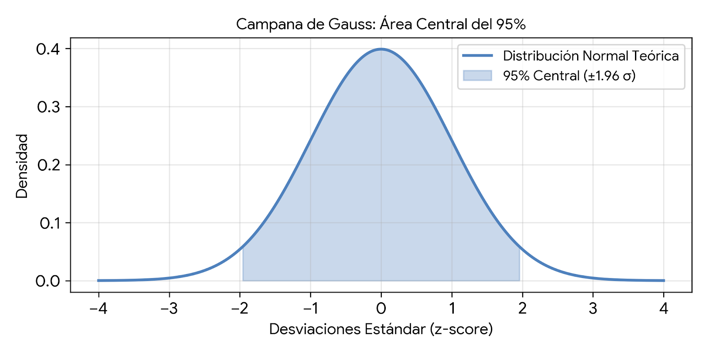

<style>
p { text-align: justify; }
h1, h2, h3, h4 { text-align: center; }
h1.title, h4.author, h4.date { text-align: left; }
pre, code { text-align: left; }
</style>


# Descriptive Analysis in R

A dataset will be analyzed using the R language with the R Markdown tool, generating an HTML file and a Word file containing the three model tables through the following steps:

  1. Document configuration and libraries
  2. Introduction and methodological justification
  3. Generation and presentation of model table 1 (Statistical test for normality)
  4. Generation and presentation of model table 2 (Treatment vs. Extension)
  5. Generation and presentation of model table 3 (Stratification by age)
  6. Results
  7. Analysis conclusions
  8. References


# Document Configuration and Libraries

First, the R Markdown file will be configured with the following characteristics:

``` {}

First, the R Markdown file will be configured with the following characteristics:

        ◦ title: "UNIR Bioinformatics Master's Activity 2 Resolution (2026)".
        ◦ author: "Name and Surnames".
        ◦ date: "yyyy-mm-dd".
        ◦ output: html_document.
  
This will generate the R Markdown environment to begin the workflow.

``` 

The following packages will be used for the analysis: dplyr, stats, gt, gtsummary, tidyverse, ggplot2, car, and nortest.

``` {r}
# The following packages will be installed: 

## install.packages(c("tidyverse", "gtsummary", "gt", "rmarkdown", "knitr", "stats", "ggplot2"))
``` 

To use them throughout the entire code, they will be applied as follows:

```{r, message=FALSE, warning=FALSE}
knitr::opts_chunk$set(echo = TRUE, warning = FALSE, message = FALSE)

# Joint loading of all required packages for analysis and formatting.
library(tidyverse)
library(gtsummary)
library(gt)
library(rmarkdown)
library(knitr)
library(stats)
```

The provided dataset is imported to perform the analysis.

```{r, message=FALSE, warning=FALSE}
library(readr) # Allows loading the dataset
dataset_genes <- read_csv("MUBioinfo_dataset_genes_oct2025.csv") # Saves the dataset into the dataset_genes object using read_csv for comma-delimited files
dataset_genes # Displays the data
```

# Introduction and Methodological Justification

## Introduction

This descriptive analysis was conducted using a database containing clinical information from 65 patients. Although the instructions specified the evaluation of 40 genes, the analyzed dataset actually comprises a total of 30 genes, along with biochemical, symptomatological, and sociodemographic variables. The methodological study was structured along two main axes: 1) the function of the treatment and the type of tumor extension, and 2) the stratification of patients according to the age category based on the median.

## Main Objective

    "To analyze the database using the clinical, sociodemographic, and gene expression profile of 65 patients through normality verification and the calculation of descriptive and comparative statistics stratified by treatment, tumor extension, and age groups."

## Secondary Objectives:

   1. To evaluate the normal distribution of gene expression in the sample using statistical tests to determine whether parametric (Shapiro-Wilk) or non-parametric (Wilcoxon) statistics are appropriate.
   2. To compare the clinical and genetic profiles of patients based on the treatment received and the type of tumor extension.
   3. To analyze gene expression by stratifying the study population according to the median age.

Methodological Justification

The methodological study was structured along two main axes: 1) the function of the treatment and the type of tumor extension, and 2) the stratification of patients according to the age category based on the median. Additionally, data normality is analyzed since it has been reported that gene expression often exhibits non-parametric distributions; therefore, the use of robust statistical tests will be prioritized, such as the Shapiro-Wilk test to verify normality, the Wilcoxon test (non-parametric), and analysis using medians and interquartile ranges.


# Generation and Presentation of Model Table 1 (Statistical Normality Test)

The Shapiro-Wilk test is considered, which evaluates the Gaussian bell curve assuming that data normality lies within a 95% confidence level, applying a decision rule with a significance level of $\alpha = 0.05$ (95% confidence level), whose complement is $1 - \alpha = 0.95$. To achieve this, it must be verified by setting up the following hypotheses:

Taking into account the following:

``` {r, echo=FALSE, fig.align='center', out.width='80%'}




```

The following hypotheses are formulated:

   Null hypothesis ($H_0$): The gene expression data originate from a population with a normal distribution.

   Alternative hypothesis ($H_1$): The gene expression data do not follow a normal distribution.

Where the $p$-value is considered as follows:

If the $p$-value $> 0.05$, $H_0$ is not rejected, concluding that normality exists.

If the $p$-value $< 0.05$, we conclude that normality does not exist.

We can observe that when analyzing normality with Shapiro-Wilk, our table shows that the data have a $p$-value $< 0.05$. Analyzing the Gaussian bell curve, we know that the data do not fall within the 95% confidence level, leading to the conclusion that the data are not normally distributed.

```{r}
# 1. Automatically identify genes
# Use grep() if it is known that genes start with "AQ_", identifying all columns containing that prefix

gene_list <- grep("^AQ_", names(dataset_genes), value = TRUE)

## 2. Create empty vectors to store the results

p_values <- numeric(length(gene_list))
interpretation <- character(length(gene_list))

## 3. Loop to calculate Shapiro-Wilk test for each gene

for(i in seq_along(gene_list)){
  current_gene <- gene_list[i]

  # Extract the gene column while omitting potential missing values (NA)

  gene_data <- na.omit(dataset_genes[[current_gene]])

  # Calculate p-value

  p_val <- shapiro.test(gene_data)$p.value

  # Store rounded results

  p_values[i] <- ifelse(p_val < 0.0001, sprintf("%.1e", p_val), sprintf("%.3f", p_val))
  interpretation[i] <- ifelse(p_val > 0.05, "Normal", "Non-normal")
   }

  # Store genes

  genes <- dataset_genes %>% 
    select(starts_with("AQ_")) %>% 
    colnames()
  
  # Build the table
  
  tabla_1 <- tibble(
    "Variable" = genes,
    "Test used" = rep("Shapiro-Wilk", length(genes)),
    "P-value" = p_values,
    "Interpretation" = interpretation
    )

```

The table is then modified with the requested characteristics.

``` {r}
library(gt) # Key library for visual design

# Take the already created data frame 

tabla_1_final <- tabla_1 %>% 
  gt() %>%
  # Add the title 
  tab_header(
    title = md("**Model Table 1.** Gene expression normality analysis")
  ) %>% 
       # Center the content of the columns
       cols_align(
         align = "center",
         columns = everything()
       ) %>% 
  # Format header with gray background and bold text 
  tab_style(
    style = list(
      cell_fill(color = "#EFEFEF"), # Gray color
      cell_text(weight = "bold")
    ),
    locations = cells_column_labels(columns = everything())
  ) %>% 
  
  # Create full grid (borders on all cells)
  tab_style(
    style = cell_borders(
      sides = "all",
      color = "black",
      weight = px(1)
    ),
    locations = list(
      cells_body(),
      cells_column_labels()
    )
  ) %>% 
  
  # Set top and bottom borders to black 
  
  tab_options(
    table.border.top.color = "black",
    table.border.bottom.color = "black",
    table_body.border.bottom.color = "black"
  ) %>%

# Add the footnote

tab_source_note(
    source_note = "Note: N=65. The Shapiro-Wilk statistical test was applied. A p-value < 0.05 assumes a non-normal distribution."
  )
# Print the final table with desired styles

tabla_1_final
```

# Generation and Presentation of Model Table 2 (Treatment vs. Extension).

When working with clinical and genomic data, such as biochemical tests and gene expression, it is very common for variables not to follow a normal distribution. This occurs because in biology it is frequent to find patients with unusually high or low values (known as outliers). As Ghasemi and Zahediasl (2012) point out, when dealing with this type of data, it is inappropriate to use the arithmetic mean, as these extreme values easily alter it. Instead, the most correct approach is to use the median (the 50th percentile). The great advantage of the median is that it simply orders the data from lowest to highest and selects the central value, meaning outliers do not affect it.

On the other hand, to measure data dispersion, we should not use the standard deviation either. This measure is designed for symmetrical data, assuming that values are distributed equally to the left and right of the mean. If we apply the standard deviation to skewed data, we could end up calculating biologically impossible ranges (such as obtaining negative expression levels). To avoid this error, in this work we will use the interquartile range (IQR or p25-p75). This measure is much more precise for our data because it analyzes exactly the block where the central 50% of the patients is concentrated, trimming the 25% lowest and 25% highest values.

Descriptive statistics of the untransformed values are calculated and analyzed using the median + interquartile range (p25-p75) since these data lack normality, utilizing biochemical, symptomatic, sociodemographic, and gene variables.

``` {r}
## 1. Prepare the selected gene data of interest for variables based on treatment and tumor extension

datos_tratamiento <- dataset_genes %>%
  filter(extension %in% c("metastasico", "localizado")) %>%
  # CRITICAL: Force ordering to match the image exactly
  mutate(
    tratamiento = factor(tratamiento, levels = c("placebo", "farmaco"), labels = c("Placebo", "Fármaco")),
    extension = factor(extension, levels = c("metastasico", "localizado"))
  ) %>%
  select(extension, tratamiento, starts_with("AQ_"))

## 2. Generate the table for model 2 
tabla_2 <- datos_tratamiento %>%
  tbl_strata(
    strata = tratamiento, # Level 1 (Top row): Placebo and Drug
    .tbl_fun = ~ .x %>% 
      tbl_summary(
        by = extension, 
        statistic = all_continuous() ~ "{median} ({p25}, {p75})",
        # Limit all continuous variables to 2 decimals
        digits = all_continuous() ~ 2,
        missing = "no" 
      ) %>%
      add_p(test = all_continuous() ~ "wilcox.test", pvalue_fun = function(x) ifelse(is.na(x), NA_character_, ifelse(x < 0.001, sprintf("%.2e", x), sprintf("%.2f", x)))) %>%
      # Level 3 (Bottom row): Rename to "Mean (SD) or P50 (IQR)"
      modify_header(
        label = "**Variable**",
        stat_1 = "**Mean (SD) or P50 (IQR)**",
        stat_2 = "**Mean (SD) or P50 (IQR)**",
        p.value = "**p-value**"
      ) %>%
      
      # Level 2 (Middle row): Tumor extension names
      modify_spanning_header(
        stat_1 ~ "**metastatic** (n={n})",
        stat_2 ~ "**localized** (n={n})"
      ) %>%
      
      # Clear automatic footnotes added by gtsummary by default
      modify_footnote(everything() ~ NA)
  ) %>%
  as_gt() %>% 
  
  tab_header(
    title = md("**Model Table 2.** Descriptive analysis of genes by treatment and tumor extension")
  )

# Display table 
tabla_2
```
Modification of the base table according to the requested parameters

``` {r}
## 1. Prepare data
datos_tratamiento <- dataset_genes %>%
  filter(extension %in% c("metastasico", "localizado")) %>%
  # CRITICAL: Force ordering to match the image exactly
  mutate(
    tratamiento = factor(tratamiento, levels = c("placebo", "farmaco"), labels = c("Placebo", "Drug")),
    extension = factor(extension, levels = c("metastasico", "localizado"))
  ) %>%
  select(extension, tratamiento, starts_with("AQ_"))

## 2. Generate table for model 2 
tabla_2 <- datos_tratamiento %>%
  tbl_strata(
    strata = tratamiento, # Level 1 (Top row): Placebo and Drug
    .tbl_fun = ~ .x %>% 
      tbl_summary(
        by = extension, 
        statistic = all_continuous() ~ "{median} ({p25}, {p75})",
        # Limit all continuous variables to 2 decimals
        digits = all_continuous() ~ 2,
        missing = "no" 
      ) %>%
      add_p(test = all_continuous() ~ "wilcox.test", pvalue_fun = function(x) ifelse(is.na(x), NA_character_, ifelse(x < 0.001, sprintf("%.2e", x), sprintf("%.2f", x)))) %>%
      # Level 3 (Bottom row): Rename to "Mean..."
      modify_header(
        label = "**Variable**",
        stat_1 = "Mean (SD) or P50 (IQR)",
        stat_2 = "Mean (SD) or P50 (IQR)",
        p.value = "**p-value**"
      ) %>%
      
      # Level 2 (Middle row): Tumor extension names
      modify_spanning_header(
        stat_1 ~ "**metastatic** (n={n})",
        stat_2 ~ "**localized** (n={n})"
      ) %>%
      
      # Clear automatic footnotes added by gtsummary by default
      modify_footnote(everything() ~ NA)
  ) %>% 
  
  ## 3. Apply exact visual formatting with gt
  as_gt() %>% 
  
  # Title
  tab_header(
    title = md("**Model Table 2.** Descriptive analysis of genes by treatment and tumor extension")
  ) %>%
  
  # Center text across the entire table
  cols_align(
    align = "center", 
    columns = everything()
  ) %>%
  
  # Paint header grid with light gray background
  tab_style(
    style = list(
      cell_fill(color = "#F0F0F0"),
      cell_text(weight = "bold", align = "center")
    ),
    locations = list(
      cells_column_labels(),
      cells_column_spanners()
    )
  ) %>%
  
  # Activate full black borders (grid)
  tab_style(
    style = cell_borders(sides = "all", color = "black", weight = px(1)),
    locations = list(
      cells_body(),
      cells_column_labels(),
      cells_column_spanners()
    )
  ) %>%
  
  # Add the required footnote as specified in the template
  tab_source_note(
    source_note = "Notes: Median (Q1, Q3), Wilcoxon rank sum exact test"
  )

# Display table 
tabla_2

```

# Generation and Presentation of Model Table 3 (Age Stratification)

The primary objective is to analyze whether age influences gene expression levels in patients. The sample is classified into two age categories using the median. Category 1 includes individuals with an age below the 50th percentile, and Category 2 groups those with an age greater than or equal to the 50th percentile.

The justification for dividing the data in this manner is to ensure the cohort is split evenly down the middle. Having two equally sized and well-balanced groups makes the results of the non-parametric Wilcoxon statistical test much more reliable.

Additionally, only the gene variables will be used, excluding biochemical, symptom, and sociodemographic variables. The rationale for excluding this clinical "noise" is to observe directly and clearly the biological effect of the age factor on the patients' transcriptomic profile.


``` {r}
# 1. Calculate the cutoff point (50th percentile / median of age)

median_age <- median(dataset_genes$edad, na.rm = TRUE)

# 2. Prepare data to create the new age category 
datos_tabla_3 <- dataset_genes %>%
  mutate(
    # Categorize patients
    edad_cat = ifelse(
      edad < median_age,
      "Age_cat < 50th percentile",
      "Age_cat >= 50th percentile"
    ),
    # Convert to factor to ensure "< 50th percentile" appears first in the table column
    edad_cate = factor(
      edad_cat,
      levels = c("Age_cat < 50th percentile", "Age_cat >= 50th percentile")
    )
  ) %>%
  # Select exclusively the new category and all genes (AQ_)
  select(edad_cat = edad_cate, starts_with("AQ_"))

# 3. Build Table 3 

tabla_3 <- datos_tabla_3 %>%
  tbl_summary(
    by = edad_cat, # Group by the new category variable
    statistic = all_continuous() ~ "{median} ({p25}, {p75})", # P50 (IQR) format
    digits = all_continuous() ~ 2,
    missing = "no"
  ) %>%
  # Add p-value column using the non-parametric test
  add_p(test = all_continuous() ~ "wilcox.test", pvalue_fun = function(x) ifelse(is.na(x), NA_character_, ifelse(x < 0.001, sprintf("%.2e", x), sprintf("%.2f", x)))) %>% 
  # Modify headers
  modify_header(
    label = "**Variable**",
    stat_1 = "Mean (SD) or P50 (IQR)",
    stat_2 = "Mean (SD) or P50 (IQR)",
    p.value = "**P-value**"
  ) %>% 
  # Add upper header spanning row
  modify_spanning_header(
    stat_1 ~ "**Age cat < 50th percentile**",
    stat_2 ~ "**Age cat \u2265 50th percentile**"
  ) %>%
  # Clear automatic footnotes added by gtsummary by default
  modify_footnote(everything() ~ NA) %>% 
  
  ## 4. Apply exact visual formatting with gt
  as_gt() %>% 
  
  # Title
  tab_header(
    title = md("**Model Table 3**. Gene expression analysis based on patient age (< and \u2265 50th percentile)")
  ) %>%
  
  # Center text across the entire table
  cols_align(
    align = "center", 
    columns = everything()
  ) %>%
  
  # Paint header grid with light gray background
  tab_style(
    style = list(
      cell_fill(color = "#F0F0F0"),
      cell_text(weight = "bold", align = "center")
    ),
    locations = list(
      cells_column_labels(),
      cells_column_spanners()
    )
  ) %>%
  
  # Activate full black borders (grid)
  tab_style(
    style = cell_borders(sides = "all", color = "black", weight = px(1)),
    locations = list(
      cells_body(),
      cells_column_labels(),
      cells_column_spanners()
    )
  ) %>%
  
  # Add the required footnote as specified in the template
  tab_source_note(
    source_note = "Notes: Median (Q1, Q3), Wilcoxon rank sum exact test"
  )

# Display Table 3  

tabla_3
``` 

# Resultados

## The results obtained for Table 1 are as follows:

The evaluation of the gene panel using the Shapiro-Wilk statistical test ($N=65$) demonstrates that none of the variables follow a normal distribution. This is evidenced by the resulting $p$-values from the test being extremely small, falling within the order of $e^{-08}$ and $e^{-09}$. Given that the established methodological criterion assumes a non-normal distribution for any $p$-value $< 0.05$, the normality hypothesis is categorically rejected for 100% of the analyzed genes.

``` {r, echo=FALSE, fig.align='center', out.width='80%'}
# Save the table as a PNG image
gtsave(tabla_1_final, filename = "Tabla_Modelo_1.png")
knitr::include_graphics("Tabla_Modelo_1.png")

``` 
## The results obtained for Table 2 are as follows:

Configuring descriptive statistics to two decimal places successfully captured the biological variability of the sample. The results demonstrate that tumor extension has a highly significant impact on the expression of genes AQ_actb, AQ_gapdh, and AQ_b2m. As tumor extension progresses, gene expression collapses dramatically, dropping from a median of 0.50 to a near-basal level of 0.05. This tenfold downregulation is supported by extremely low $p$-values ($1.71 \times 10^{-9}$ in placebo and $3.33 \times 10^{-9}$ with the drug). On the other hand, when comparing therapeutic groups, it is evident that the treatment fails to alter this genetic profile. The medians and the collapse in expression are identical in both placebo and drug-treated patients. In conclusion, the only factor determining the behavior of these genes is tumor extension, along with resistance to pharmacological intervention.

``` {r, echo=FALSE, fig.align='center', out.width='80%'}
# Save the table as a PNG image
gtsave(tabla_2, filename = "Tabla_Modelo_2.png")
knitr::include_graphics("Tabla_Modelo_2.png")

``` 

## The results obtained for Table 3 are as follows:

Although the younger group appears to have higher medians, the precise $p$-values (e.g., 0.19, 0.68, 0.75) confirm that, due to the enormous overlap of the Interquartile Ranges (IQR), these differences completely lack statistical significance for 28 of the 30 analyzed genes. The genes that actually crossed the alpha threshold ($< 0.05$) are AQ_pten, with a $p$-value of $0.02$, and AQ_casp3, which maintains a $p$-value of $0.00$ (suggesting a $p$-value $< 0.01$).

``` {r, echo=FALSE, fig.align='center', out.width='80%'}
# Save the table as a PNG image
gtsave(tabla_3, filename = "Tabla_Modelo_3.png")
knitr::include_graphics("Tabla_Modelo_3.png")

```

# Conclusions

The results presented in Model Table 1 demonstrate that the lack of normality justifies and makes strictly mandatory the abandonment of any parametric test, officially validating the use of the Median and Interquartile Range for descriptive statistics.

The results presented in Model Table 2 demonstrate that tumor extension is the central and determining biological factor in the drastic downregulation of the AQ_actb, AQ_gapdh, and AQ_b2m genes, as tumor progression alone induces a collapse in gene expression toward basal levels. A clear therapeutic resistance is evidenced in this specific profile, given that this drop occurs identically in both the drug and placebo groups. Therefore, it is concluded that the alteration of these genes responds exclusively to the natural progression of the pathology rather than pharmacological intervention.

The results presented in Model Table 3 strictly demonstrate that the chronological age of the patients is not a determining factor in the overall modulation of the gene profile. For 28 of the 30 analyzed genes, the $p$-values exceed the significance threshold ($p > 0.05$). This shows that tumor gene expression is homogeneous and independent of the individual's chronological age. The only statistical exceptions are AQ_pten ($p = 0.02$) and AQ_casp3 ($p < 0.01$). This suggests that although the global transcriptome is stable with respect to age, certain specific pathways associated with tumor suppression and apoptosis do exhibit variations strictly linked to the patient's age.

# References

 1. Ghasemi, A., & Zahediasl, S. (2012). Normality tests for statistical analysis: a guide for             non-statisticians. International journal of endocrinology and metabolism, 10(2), 486–489. https://doi.org/10.5812/ijem.3505
 2. Vetter T. R. (2017). Descriptive Statistics: Reporting the Answers to the 5 Basic Questions of Who, What, Why, When, Where, and a Sixth, So What?. Anesthesia and analgesia, 125(5), 1797–1802. https://doi.org/10.1213/ANE.0000000000002471

# Session

```  {r}

# General information on versions

sessionInfo()

# Summary of key library versions
version_info <- tibble(
  Package = c("R", "gt", "gtsummary", "tidyverse", "knitr", "stats"),
  Version = c(
    as.character(getRversion()),
    as.character(packageVersion("gt")),
    as.character(packageVersion("gtsummary")),
    as.character(packageVersion("tidyverse")),
    as.character(packageVersion("knitr")),
    as.character(packageVersion("stats"))
  )
)

# Display the formatted table
version_info %>%
  gt() %>%
  tab_header(
    title = md("**Session Information.** Software and package versions used in the analysis")
  ) %>%
  cols_align(align = "center", columns = everything()) %>%
  tab_style(
    style = list(cell_fill(color = "#F0F0F0"), cell_text(weight = "bold")),
    locations = cells_column_labels(columns = everything())
  ) %>%
  tab_style(
    style = cell_borders(sides = "all", color = "black", weight = px(1)),
    locations = list(cells_body(), cells_column_labels())
  )
``` 
